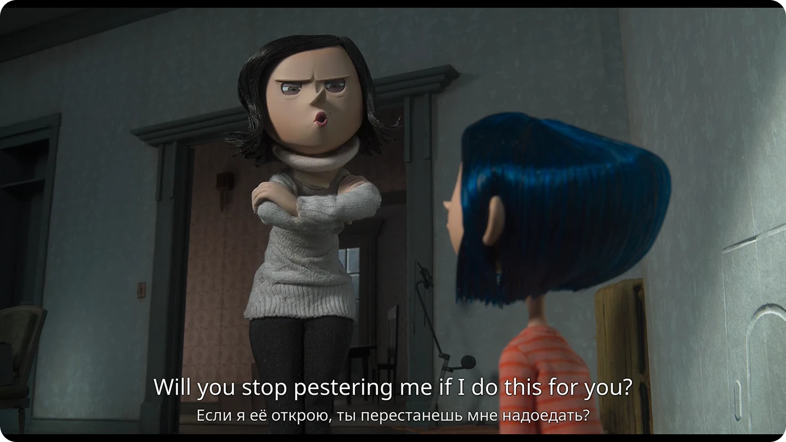
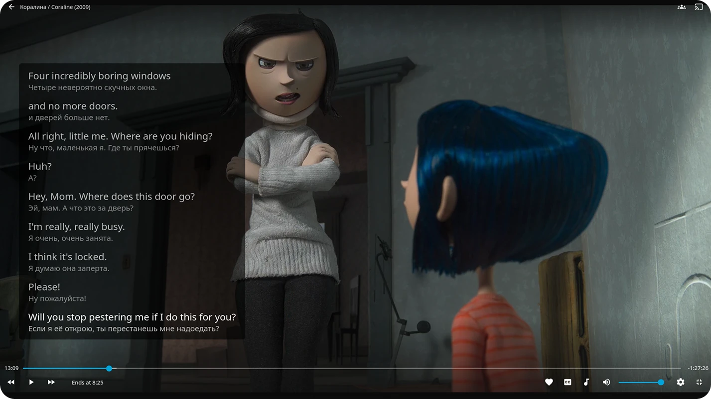
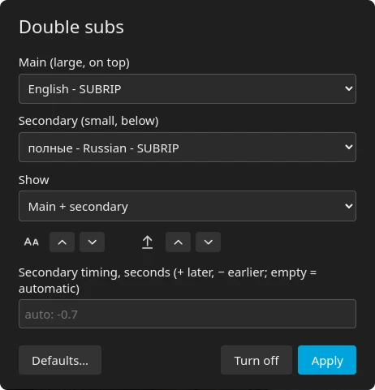

# Jellyfin Double Subs

<p align="center">
  <a href="https://github.com/Artieficr/jellyfin-double-subs/releases/latest"></a>
  <a href="https://github.com/Artieficr/jellyfin-double-subs/releases"></a>
  
  <a href="https://ko-fi.com/artieficr"></a>
</p>

Watch with two subtitle languages at once in Jellyfin.



- **Double subs** option in the player's subtitles menu: pick a main and a secondary language.
  Main is shown larger above the smaller secondary. You can show one or both.
- **Pause history:** pausing shows the latest subtitle lines in both languages, newest at the bottom,
  as many as fit the screen.
- **Click to rewind:** click a line in the history to jump to where it starts.
- **Default languages** (gear icon next to Double subs): Double subs turns on by itself when a file
  has both. Saved per user on the server, so they follow you across devices.
- **Size and position:** arrows in the Double subs dialog make the subtitles bigger or smaller (both
  languages together) and move them up or down, with a live preview.
- **Timing alignment:** if one language's subtitles are shifted against the other's, the shift is
  detected and corrected on screen (or set it by hand). Your subtitle files are never changed.
- **Text, Blu-ray (PGS) and DVD (VobSub) subtitles**, including mixed.

**Pause history:** the latest lines in both languages. Click one to jump back to it.



**Double subs dialog:** pick the languages, what to show, size and position, and the timing of the
secondary language.



## Install

Needs Jellyfin **12.4** or newer. No other plugins needed.

1. Dashboard → Plugins → **Repositories** → add this URL:
   ```
   https://raw.githubusercontent.com/Artieficr/jellyfin-double-subs/main/manifest.json
   ```
2. Find **Double Subs** in the plugin catalog, install it, and restart the server.
3. Reload Jellyfin in your browser, or restart the app.

Updates show up in the catalog like any other plugin's. To check it's running, open the browser
console: it logs `[doublesubs] 0.1.0 loaded`.

The plugin adds a script to the web client's page as the server sends it; the web client's files
on disk aren't modified.

## Where it works

The Jellyfin web client and apps built on it: Jellyfin Desktop / Media Player, the Android and iOS
apps using the web player, LG webOS and Samsung Tizen apps. So far it has been tested in Jellyfin
Desktop 2.0 on Linux.

Not in native players: Android TV, Swiftfin, or the Android app's "Integrated player".

## Known limitations

- DVD (VobSub) subtitles haven't been tested with a real file yet (only the decoding was checked).
- TV remote navigation is in, but hasn't been tried on an actual TV yet.

## Development

- `web/doublesubs.js`: the client script (all the features). Plain JavaScript, no build step.
- `Jellyfin.Plugin.DoubleSubs/`: the server plugin. It embeds the script and serves it at
  `/DoubleSubs/doublesubs.js`. Build with `dotnet build` (.NET 10 SDK).
- `node test/check.mjs` runs the self-check.

Releases: set the same version in `VERSION` (`web/doublesubs.js`) and `<Version>` (the `.csproj`),
then create a GitHub release with that tag (e.g. `0.1.0`). The workflow checks the versions,
builds the plugin, attaches the zip and adds the version to `manifest.json`.

## License

[MIT © Artyom Tsoy](https://github.com/Artieficr/jellyfin-double-subs/blob/main/LICENSE.txt)
